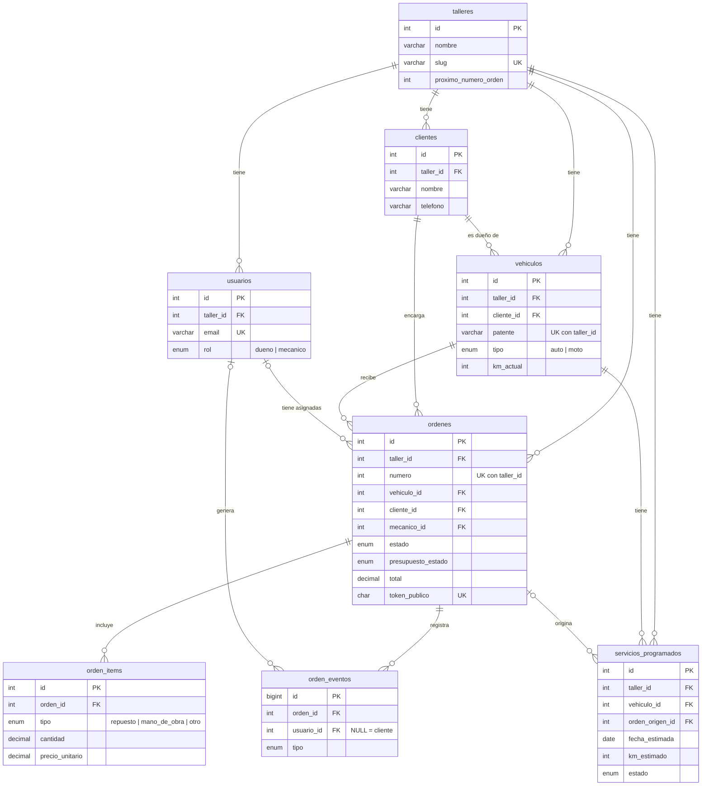
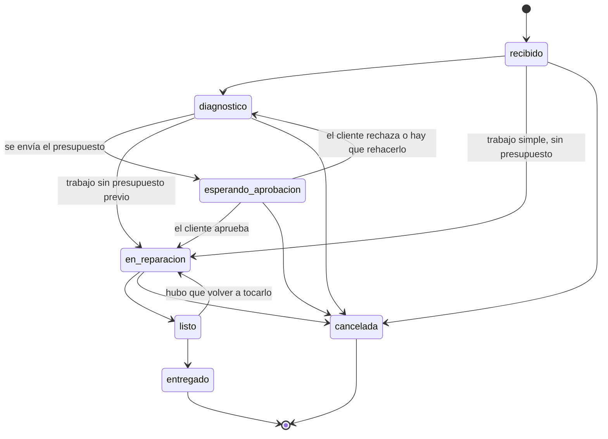

# Base de datos

Modelo de datos del MVP de Taller Digital. El schema completo está en [`database/schema.sql`](../database/schema.sql) y el diagrama editable en [`docs/diagrama-bd.drawio`](diagrama-bd.drawio) (abrilo en [app.diagrams.net](https://app.diagrams.net) o con la extensión Draw.io de VS Code).

## Diagrama

## Tablas

| Tabla | Para qué sirve |
|---|---|
| `talleres` | Cada taller que usa el sistema (el tenant). Guarda el contador de números de orden. |
| `usuarios` | Dueño y mecánicos. El email es único en todo el sistema para que el login no pida elegir taller. |
| `clientes` | Los dueños de los vehículos. El teléfono se guarda en formato internacional para armar links `wa.me`. |
| `vehiculos` | Autos y motos. La patente es única dentro de cada taller y se guarda normalizada (`AE482KT`). |
| `ordenes` | La orden de trabajo, con su estado y el presupuesto. Es el centro del modelo. |
| `orden_items` | Los renglones del presupuesto: repuestos, mano de obra u otros. |
| `orden_eventos` | Bitácora de todo lo que pasa en una orden. Alimenta la línea de tiempo que ve el cliente. |
| `servicios_programados` | Próximos services a recordar, por fecha, por kilometraje o por ambos. |

## Estados de la orden

Las transiciones válidas se validan en el backend (`backend/src/modules/ordenes/ordenes.estados.js`), no en la base. Cada cambio de estado inserta un registro en `orden_eventos` con `estado_desde` y `estado_hasta`.

## Reglas del presupuesto

- El presupuesto vive dentro de la orden (`presupuesto_estado`, `total` y sus `orden_items`).
- Al enviarlo, pasa a `enviado` y la orden a `esperando_aprobacion`.
- Si se modifican ítems de un presupuesto `enviado`, vuelve a `borrador`, la orden vuelve a `diagnostico` y hay que reenviarlo.
- Si el presupuesto ya está `aprobado`, se pueden sumar ítems durante la reparación sin invalidarlo.
- Si el cliente aprueba por teléfono, el taller pasa la orden a `en_reparacion` y eso registra la aprobación.
- `ordenes.total` es un cache de `SUM(cantidad * precio_unitario)` y se recalcula en la misma transacción que modifica los ítems.

## Decisiones de diseño

**Multi-tenant por fila.** Todas las tablas de negocio llevan `taller_id` y todas las consultas filtran por el `taller_id` del token del usuario. Es más simple de operar que una base por taller y alcanza de sobra para cientos de talleres. `orden_items` y `orden_eventos` no lo llevan porque siempre se acceden a través de su orden.

**Número de orden correlativo por taller.** Se toma de `talleres.proximo_numero_orden` con `SELECT ... FOR UPDATE` dentro de la transacción que crea la orden, para evitar números repetidos si dos personas crean órdenes a la vez.

**La orden guarda el cliente.** Un vehículo puede cambiar de dueño. `vehiculos.cliente_id` es el dueño actual y `ordenes.cliente_id` el de ese momento, así el historial no se reescribe.

**Token público en lugar de ID.** El link del cliente usa `token_publico` (32 caracteres aleatorios), así no se puede adivinar la orden de otro cambiando un número en la URL.

**Borrado lógico.** Clientes y vehículos usan `deleted_at` porque tienen historial asociado. Las órdenes no se borran: se cancelan.

## Qué revisar cuando crezca

- **Varios presupuestos por orden** (por ejemplo, uno ampliado a mitad del trabajo): pasar a una tabla `presupuestos` con versiones.
- **Stock de repuestos:** tabla `repuestos` y que `orden_items` referencie opcionalmente un repuesto.
- **Pagos y facturación:** tablas `pagos` y `facturas` asociadas a la orden.
- **Fotos:** tabla `orden_adjuntos` con URLs a un storage externo (S3, R2 o similar).
